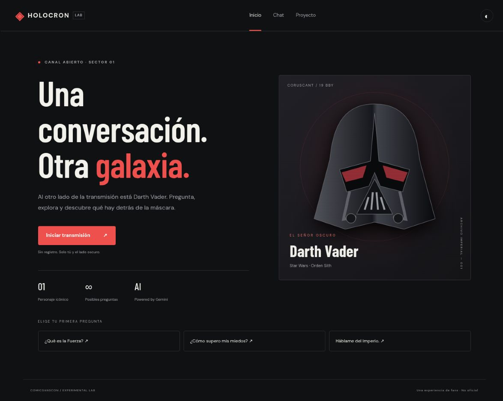
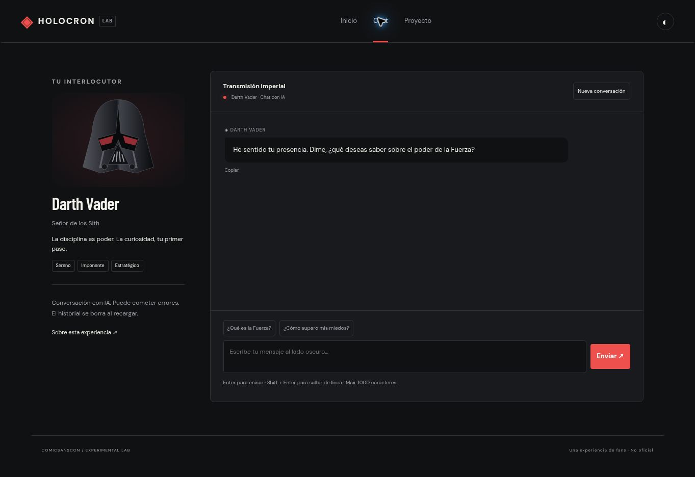

# Holocron — Chatea con Darth Vader

POC educativa para ComicSansCon. SPA mobile-first en JavaScript vanilla que permite conversar con una interpretación de Darth Vader usando Google Gemini y una Vercel Function.

**Estado real de esta entrega:** código implementado, 21 tests automatizados aprobados y build generado. La llamada real a Gemini y el despliegue público no se verificaron: falta configurar una clave y conectar una cuenta de Vercel. No se ha creado un repositorio remoto.

- URL de producción: pendiente de despliegue.
- Repositorio GitHub: pendiente de publicación.
- No presentar la entrega como desplegada hasta completar esos dos puntos.

## Personaje

Darth Vader (Star Wars): solemne, firme, reservado y estratégico. El prompt de sistema está exclusivamente en `api/functions.js`. Define personalidad, respuestas de 2–4 frases, continuidad del contexto, distinción entre ficción y realidad y límites de conocimiento. El saludo inicial es texto estático; las respuestas posteriores deben provenir de Gemini. El casco es una ilustración SVG geométrica hecha para el proyecto. Experiencia no oficial, sin afiliación con Lucasfilm o Disney.

## Requisitos y ejecución local

Node.js 22 o posterior, npm, una cuenta de Vercel y una API key de Google AI Studio.

```bash
npm ci
cp .env.example .env
```

Edita `.env` **solo en tu equipo**:

```dotenv
GEMINI_API_KEY=tu_clave_real
GEMINI_MODEL=gemini-2.5-flash
```

Nunca uses `VITE_GEMINI_API_KEY`: Vite expone al cliente las variables con ese prefijo. Nunca subas `.env` a GitHub.

```bash
npx vercel login
npm run vercel:dev
```

En la primera ejecución, vincula el directorio a un proyecto Vercel y selecciona el framework Vite. Abre la dirección que imprima Vercel (habitualmente http://localhost:3000). `vercel dev` sirve tanto el frontend como `/api/functions`.

`npm run dev` sirve únicamente la interfaz con Vite: **no ejecuta la función serverless**. No es suficiente para probar la conversación real.

## Tests y build

```bash
npm test
npm run test:watch
npm run build
```

21 tests con Vitest, sin acceso a la red. `fetch` está simulado con `vi.fn` y las variables de entorno se restauran después de cada prueba. Cobertura funcional: transformación de roles, validación de historial, parseo, bloqueos de seguridad, petición y errores HTTP, recuperación del borrador, renderizado seguro de HTML, navegación SPA y proxy de servidor.

## Arquitectura

```text
api/functions.js       Proxy seguro, prompt y llamada a Gemini
src/app.js             Vistas Home/Chat/About y History API
src/chat.js            Estado en memoria, fetch, envío y renderizado
src/utils.js           Validación, transformación, parseo y formato
src/styles.css         Mobile-first, Grid/Flexbox, temas
index.html             Entrada de Vite
vercel.json            Build, rutas directas y configuración Function
tests/                 Tests con Vitest y jsdom
docs/                  Evidencias y registro de uso de IA
.env.example           Nombres de variables sin secretos
```

Flujo: navegador → POST `/api/functions` → Gemini `generateContent` → extracción de `candidates[0].content.parts` → texto renderizado con `textContent`.

El cliente envía todo el historial confirmado. Los roles alternan `user` y `model`; no se acepta un rol `system` del cliente. El contexto y la clave se añaden en el servidor. El historial no se persiste en localStorage: sobrevive a cambios de ruta, pero se pierde al recargar. El botón “Nueva conversación” lo limpia.

Se limita cada mensaje del usuario a 1000 caracteres y el contexto a 40 mensajes (20 intercambios). Al alcanzar ese límite se pide comenzar otra conversación; no se descarta contexto silenciosamente. Hay un timeout de 25 segundos en servidor y 29 segundos en cliente. Los errores 429 tienen un mensaje específico; no hay reintentos automáticos que dupliquen solicitudes.

### Tokens, temperature y rate limiting

- Tokens: unidades de texto procesadas por el modelo. `maxOutputTokens: 512` limita la generación, no equivale a 512 palabras. El historial completo incrementa consumo y latencia.
- `temperature: 0.8`: permite variación en la interpretación; no garantiza exactitud.
- `thinkingBudget: 0`: configuración prevista para Gemini 2.5 Flash, enfocada en respuestas breves. Si cambias de familia de modelo revisa su compatibilidad.
- Rate limiting: Gemini puede devolver 429 por frecuencia o cuota. Se comunica el error y se invita a esperar. Esta POC no implementa un contador distribuido propio; antes de una difusión amplia configura reglas de rate limiting en Vercel y cuotas adecuadas en Google. Un contador en memoria de una Function no sería global ni persistente.
- La disponibilidad del modelo depende de la cuenta y del proveedor. `GEMINI_MODEL` permite cambiarlo; verifica también las opciones de generación.

## Navegación y responsive

`/home`, `/chat` y `/about` se renderizan sin recarga mediante `pushState`; `popstate` atiende atrás/adelante. Los rewrites de Vercel permiten abrir esas rutas directamente. `/` muestra Home. Las rutas desconocidas navegadas dentro del cliente muestran “Señal perdida”.

Diseño base para móvil, breakpoint a 768 px para tablet y a 1100 px para escritorio. Tamaños objetivo: 390×844, 768×1024 y 1440×900. Ver `docs/VALIDACION.md` para distinguir verificaciones realizadas y pendientes.

Extras implementados: timestamps, animación de escritura (respetando reducción de movimiento), Enter para enviar, Shift+Enter para nueva línea, copiar respuestas, modo claro/oscuro. El modo tampoco se persiste al recargar.

Accesibilidad: etiquetas para el formulario, navegación identificada, foco visible, enlace para saltar al contenido, mensajes con `role=log`, errores con `role=alert` y textos insertados sin interpretar HTML.

## Publicar en GitHub y Vercel

1. Crea un repositorio público vacío en GitHub llamado `holocron-chat`. No añadas inicialmente README ni `.gitignore`, pues ya están incluidos.
2. Desde este directorio:

```bash
git init
git add .
git commit -m "Implementa Holocron con Gemini, routing y tests"
git branch -M main
git remote add origin https://github.com/TU_USUARIO/holocron-chat.git
git push -u origin main
```

3. En Vercel, selecciona **Add New → Project**, importa ese repositorio y selecciona **Vite**. Root Directory: raíz del repositorio. Build Command: `npm run build`. Output Directory: `dist`.
4. En Environment Variables configura `GEMINI_API_KEY` y `GEMINI_MODEL` para Production y los entornos que utilizarás. No pongas la clave en el código ni en capturas.
5. Despliega. Si añades o cambias variables después del despliegue, haz un redeploy.
6. Comprueba `/home`, `/chat` y `/about` con acceso directo y recarga; navegación atrás/adelante; una conversación real de varios turnos; estados de carga y errores.
7. Sustituye los dos estados pendientes del inicio de este README por los enlaces reales. Añade capturas del chat con respuesta real a `docs/` y actualiza sus referencias.

Alternativa CLI, después de `npx vercel login`: `npx vercel` para vincular y desplegar Preview; configura secretos en el panel y ejecuta `npx vercel --prod` para producción.

## Capturas

Las capturas incluidas corresponden a la interfaz local. El saludo mostrado es estático y no acredita una llamada a Gemini.




## Uso de IA

Consulta `docs/USO_DE_IA.md`: prompts, decisiones, límites de lo probado y tareas de revisión del estudiante. Revisa y comprende el código antes de defender el proyecto.

## Referencias técnicas

- [Gemini: generateContent](https://ai.google.dev/api/generate-content)
- [Vite en Vercel](https://vercel.com/docs/frameworks/frontend/vite)
- [Vercel Node.js Functions](https://vercel.com/docs/functions/runtimes/node-js)
- [Vercel rewrites](https://vercel.com/docs/routing/rewrites)
